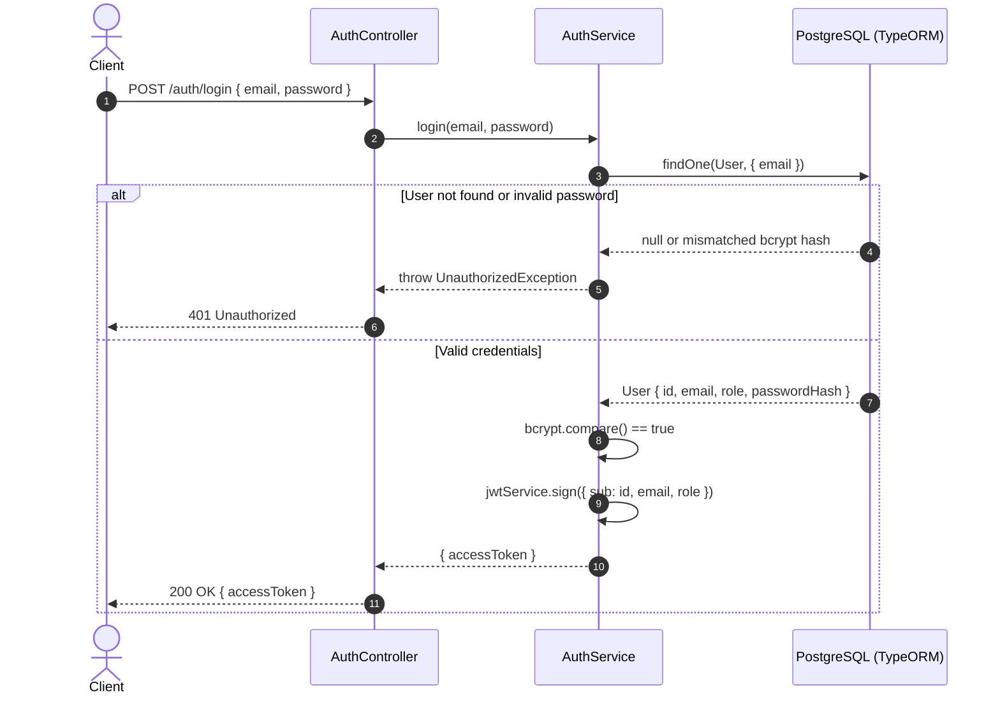
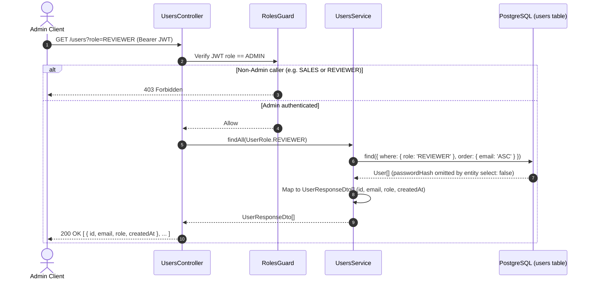
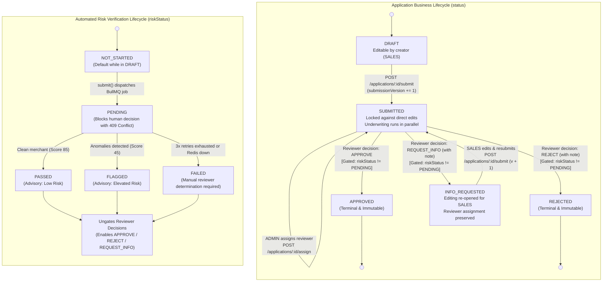
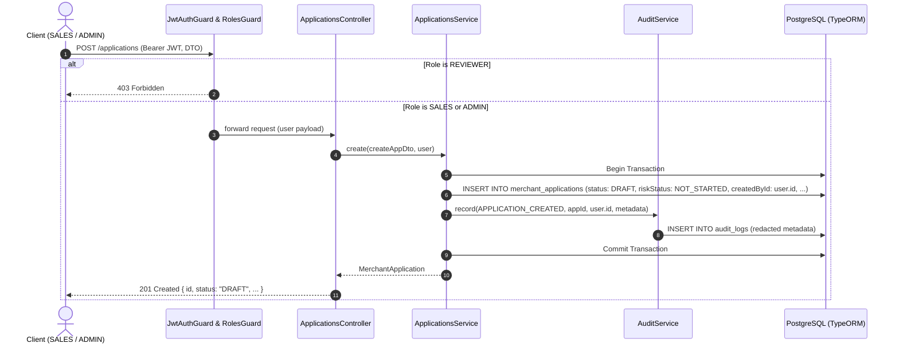
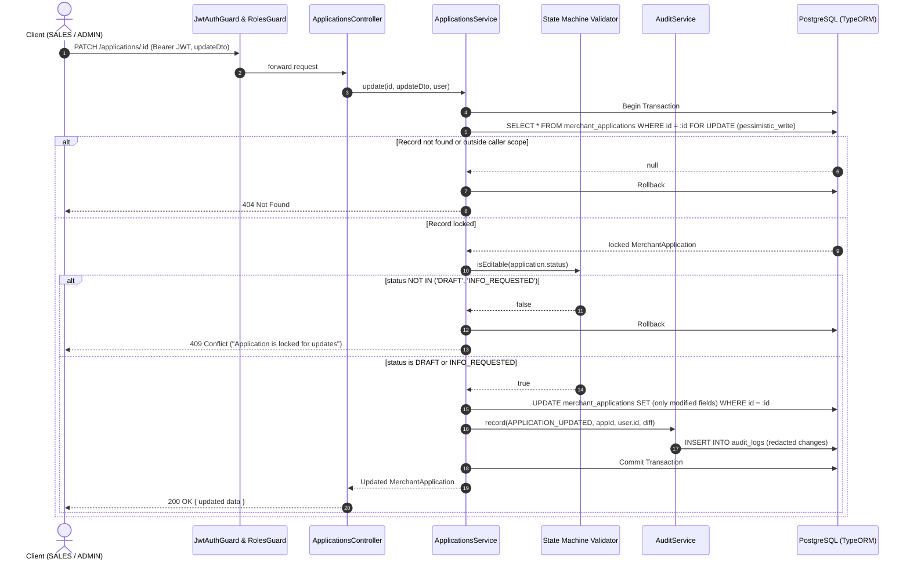
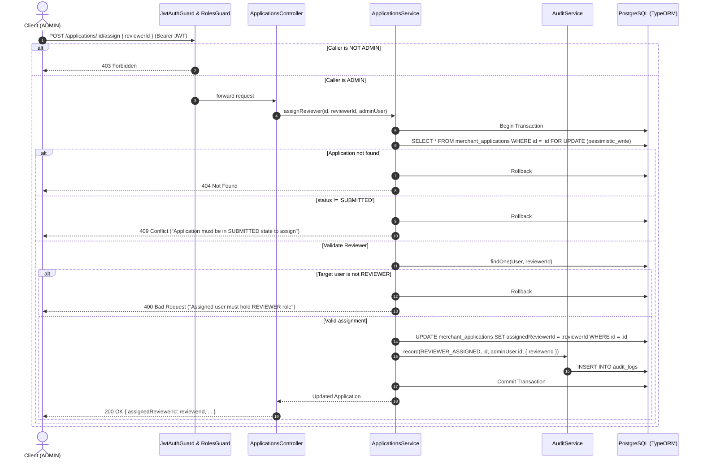
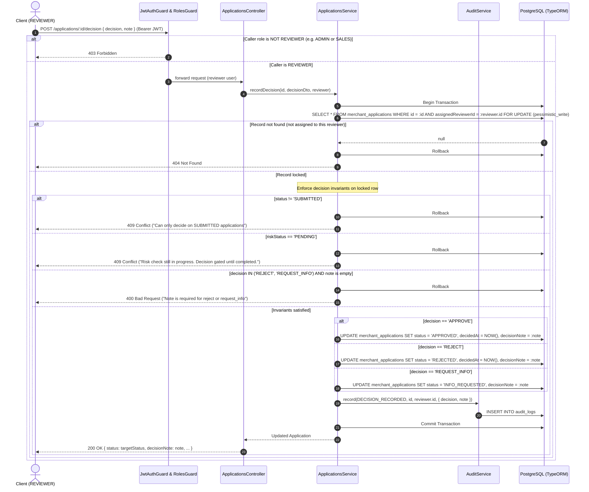
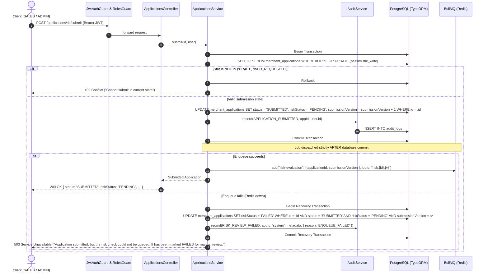
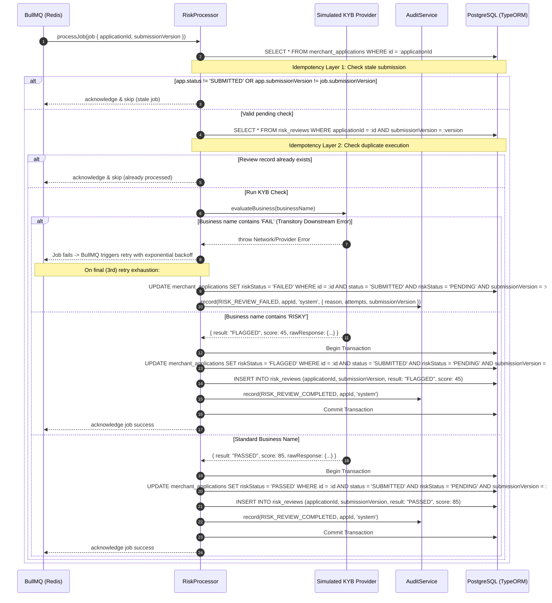
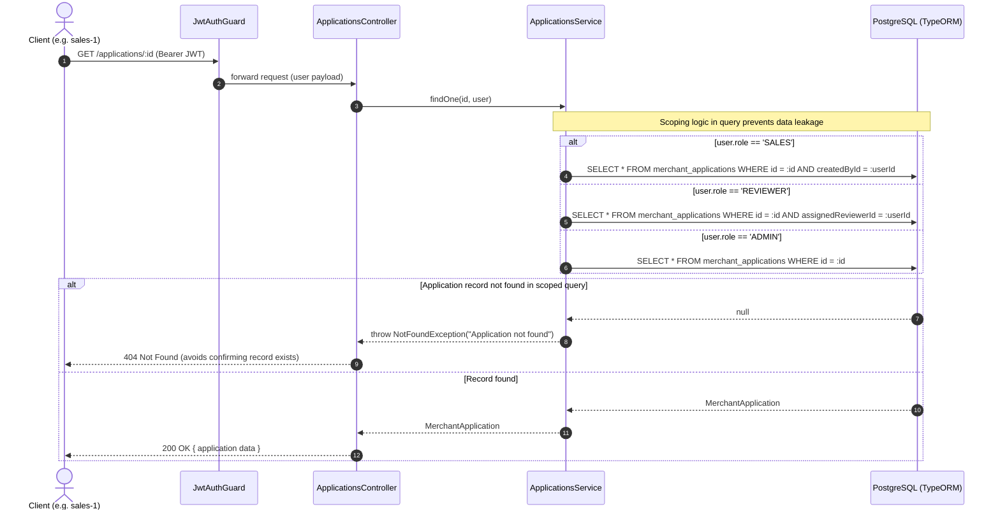

# Design: Merchant Onboarding and Risk Review API

## 1. Goal & Architecture Overview

An internal API for a payments company to onboard merchants. SALES staff create and submit merchant applications. Submitting triggers an asynchronous (simulated) third-party risk/KYB check. An ADMIN assigns the application to a REVIEWER, and only that REVIEWER can approve, reject or request more information. Every significant action is audited.

The scope covers the core domain requirements: merchant onboarding lifecycle, object-level authorization, asynchronous risk review, and audit logging. Optional production enhancements (webhook callback, secondary MongoDB audit store, separate ADR document) are deferred to prioritize domain integrity, security guarantees, and comprehensive test coverage (see section 9).

### 1.1 Technology Stack

The platform architecture consists of the following core technologies:
- **NestJS 10+ & TypeScript**: Modular dependency injection, global validation pipes, centralized exception filters, and strict typing.
- **PostgreSQL 16 & TypeORM**: Primary relational database for all domain entities and audit logs, managed strictly with reviewed migrations (`synchronize: false`).
- **Redis 7 & BullMQ 5+**: In-memory message broker and distributed queue for non-blocking asynchronous risk review processing.
- **JWT & bcrypt**: Stateless authentication tokens and secure password hashing (10 salt rounds).
- **Security Hardening (`@nestjs/throttler` & `helmet`)**: Targeted anti-brute-force rate limiting on login and secure HTTP headers configured with Swagger UI CSP compatibility.
- **Docker Compose**: Containerized local environment orchestrating PostgreSQL and Redis.
- **Jest & Supertest**: Unit testing suite for pure domain logic and integration suite for API/authorization flows.
- **OpenAPI / Swagger**: Interactive API documentation at `/api/docs`.

## 2. Entities

**User**
`id (uuid)`, `email (unique)`, `passwordHash`, `role (ADMIN | REVIEWER | SALES)`, `createdAt`

**MerchantApplication**
`id (uuid)`, `businessName`, `legalBusinessName`, `businessType (enum)`, `ownerName`, `ownerEmail`, `ownerPhone`, `requestedMonthlyVolume`, `requestedAvgTicket`, `status`, `riskStatus`, `submissionVersion (int, default 0)`, `createdById (FK User)`, `assignedReviewerId (FK User, nullable)`, `decisionNote (nullable)`, `decidedAt (nullable)`, `createdAt`, `updatedAt`

**RiskReview**
`id (uuid)`, `applicationId (FK)`, `submissionVersion`, `result (PASSED | FLAGGED)`, `score`, `rawResponse (jsonb)`, `createdAt`
Unique constraint: `(applicationId, submissionVersion)`

**AuditLog**
`id (uuid)`, `entityName`, `entityId (uuid)`, `action`, `actorId (varchar(100), 'system' for automated worker/recovery events)`, `actorRole (SYSTEM for worker)`, `metadata (jsonb, redacted)`, `createdAt`

Indexes: `MerchantApplication(createdById)`, `(assignedReviewerId)`, `(status)`; `AuditLog(entityName, entityId)`, `(actorId)`, `(createdAt)`.

### 2.1 Storage Architecture
- **Unified Relational Store**: PostgreSQL maintains transactional domain entities (`MerchantApplication`, `User`, `RiskReview`) and append-only compliance history (`AuditLog`).
- **Schema Evolution (`synchronize: false`)**: Runtime auto-synchronization is disabled to prevent accidental column drops or locks during restarts. Schema changes are applied via versioned, reviewed TypeORM SQL migrations (`src/database/migrations/*`).
- **Transaction Atomicity**: State transitions (e.g. updating status to `APPROVED`) and compliance audit entries (`AuditLog`) execute inside atomic database transactions (`dataSource.transaction`), guaranteeing zero un-audited state changes.

## 3. Roles and permissions

| Action | ADMIN | REVIEWER | SALES |
|---|---|---|---|
| Login (`POST /auth/login`) | yes | yes | yes |
| List users (`GET /users`) | yes | no | no |
| Create application (`POST /applications`) | yes | no | yes |
| View / list applications (`GET /applications`) | all | only where assigned to them | only ones they created |
| Update application (`PATCH /applications/:id`) | any | no | only ones they created |
| Submit application (`POST /applications/:id/submit`) | any | no | only ones they created |
| Assign reviewer (`POST /applications/:id/assign`) | yes | no | no |
| Record decision (`POST /applications/:id/decision`) | no | only if assigned | no |
| View compliance audit logs (`GET /audit-logs`) | yes | no | no |

### 3.1 Invariants & Security Rules
- **Decision Segregation**: Only the specifically assigned `REVIEWER` may record risk decisions (`APPROVE`, `REJECT`, `REQUEST_INFO`). `ADMIN` and other unassigned users are barred from decision endpoints.
- **Assignment Constraints**: Reviewers must hold the `REVIEWER` role. An application cannot be assigned to `SALES` or `ADMIN`.
- **User Directory for Admin Assignment (`GET /users`)**: To allow Admin users and frontend client interfaces to dynamically populate reviewer dropdowns during assignment, a scoped read endpoint `GET /users?role=REVIEWER` is provided. It is strictly restricted to `ADMIN` users (`@Roles(UserRole.ADMIN)`) and guarantees zero credential leakage by strictly excluding `passwordHash` from the response DTO.
- **Compliance Audit Trail Endpoint (`GET /audit-logs`)**: To support regulatory audit requirements and enable evaluators/administrators to verify immutable audit logs and PII redaction directly via Swagger UI without requiring raw database CLI access, a paginated read endpoint `GET /audit-logs?entityId=&action=&limit=&offset=` is provided. It is strictly restricted to `ADMIN` users (`@Roles(UserRole.ADMIN)`).
- **Internal Provisioning**: User accounts are provisioned via database seed scripts; public user registration is intentionally omitted for this internal operational platform.

### 3.2 Authentication & Token Architecture (JWT & bcrypt)
- **Password Security**: Passwords are saved as bcrypt hashes (10 salt rounds). Credentials are authenticated via `POST /auth/login`.
- **Targeted Anti-Brute-Force Rate Limiting**: `POST /auth/login` is the platform's sole public, unauthenticated endpoint. It is protected by `@nestjs/throttler` (5 attempts / minute per IP) to prevent password dictionary attacks and Bcrypt CPU starvation (~70ms per hash). Authenticated back-office endpoints (`/applications`, `/users`, `/audit-logs`) remain unthrottled to avoid disrupting internal staff workflows.
- **Stateless Authorization**: Protected routes use stateless Bearer JWTs signed with `sub` (user ID) and `role`. Guards (`JwtAuthGuard`, `RolesGuard`) validate tokens in memory without querying the database on each request.
- **Context Injection**: The verified token populates `req.user`, providing the authenticated caller identity for query scoping.

### 3.3 Authentication Flow (`POST /auth/login`)

### 3.4 User Directory Flow (`GET /users`)

## 4. Status model and Lifecycle State Machine

The system separates **Business Workflow (`status`)** from **Automated Background Verification (`riskStatus`)**. Keeping them orthogonal ensures async checks never corrupt human decision states, and vice versa.

### 4.1 Status Definitions

#### A. Application Business Status (`status`)
1. **`DRAFT`**: Initial state upon creation by `SALES` (or `ADMIN`). Fully editable.
2. **`SUBMITTED`**: Application is locked for editing and undergoing review. Open for reviewer assignment and async risk check.
3. **`INFO_REQUESTED`**: The assigned reviewer requires clarifications or corrections. Editing re-opens for `SALES`.
4. **`APPROVED`**: Final approved state. Terminal and immutable.
5. **`REJECTED`**: Final declined state. Terminal and immutable.

#### B. Asynchronous Risk Status (`riskStatus`)
1. **`NOT_STARTED`**: Initial state while application is in `DRAFT`.
2. **`PENDING`**: Triggered automatically on submission while the BullMQ worker is processing the simulated KYB check.
3. **`PASSED`**: Third-party check completed cleanly with an acceptable risk score.
4. **`FLAGGED`**: Third-party check flagged potential anomalies (advisory; human reviewer makes final call).
5. **`FAILED`**: Worker exhausted all retry attempts due to downstream outages or simulated failure.

---

### 4.2 State Transition Diagram

---

### 4.3 Lifecycle Rules & Invariants

1. **Editability**:
   - Applications can **only** be modified (`PATCH /applications/:id`) when in `DRAFT` or `INFO_REQUESTED`.
   - Once `SUBMITTED`, `APPROVED`, or `REJECTED`, all application fields are strictly locked against updates.

2. **Submission (`POST /applications/:id/submit`)**:
   - Allowed transitions: `DRAFT -> SUBMITTED` or `INFO_REQUESTED -> SUBMITTED`.
   - Atomically updates `status = SUBMITTED`, `riskStatus = PENDING`, increments `submissionVersion += 1`, writes audit log, and enqueues the async risk job (detailed in Section 5).

3. **Reviewer Assignment (`POST /applications/:id/assign`)**:
   - Permitted **only** when `status = SUBMITTED`.
   - Can **only** be performed by `ADMIN`. Target user must hold the `REVIEWER` role.
   - Assignment persists across resubmissions (i.e. if moved to `INFO_REQUESTED` and resubmitted, the assigned reviewer remains in place).

4. **Reviewer Decision (`POST /applications/:id/decision`)**:
   - Permitted **only** when:
     - Caller is the specific `assignedReviewerId` (ADMINs and other reviewers are rejected).
     - `status == SUBMITTED`.
     - `riskStatus != PENDING` (human decision is blocked until the async background check completes or reaches max retries).
   - Valid decisions:
     - `APPROVE`: Transitions to `APPROVED`. Note is optional.
     - `REJECT`: Transitions to `REJECTED`. Note is **mandatory**.
     - `REQUEST_INFO`: Transitions to `INFO_REQUESTED`. Note is **mandatory** (gives SALES actionable guidance).

5. **Terminal States**:
   - `APPROVED` and `REJECTED` are final. Any subsequent edit, submit, assign, or decision attempt returns `409 Conflict`.

6. **Single Source of Truth**:
   - All transition rules are encoded in a pure function (`canTransition(currentStatus, targetAction)`) covered by exhaustive unit tests. Controllers and services consume this single validator.

### 4.4 Lifecycle Sequence Diagrams

#### A. Create Application (`POST /applications`)

#### B. Update Application (`PATCH /applications/:id`)

#### C. Assign Reviewer (`POST /applications/:id/assign`)

#### D. Record Reviewer Decision (`POST /applications/:id/decision`)

## 5. Asynchronous Risk Flow (Redis & BullMQ Architecture)

### 5.1 Queue Architecture & Asynchronous Mechanics
- **Decoupled Execution**: Verification against external risk/KYB providers is decoupled from the synchronous HTTP request cycle. `POST /applications/:id/submit` updates the database status to `SUBMITTED`, enqueues a background job to Redis, and returns `200 OK` immediately.
- **Queue Configuration**:
  - Queue Name: `risk-evaluation`
  - Job Name: `risk-evaluation`
  - Connection: Redis (port `6379`) configured via `BullModule`
  - Producer Job Options:
    - `jobId: risk:{applicationId}:{submissionVersion}` (Deterministic deduplication key in Redis)
    - `attempts: 3` (Maximum retry attempts)
    - `backoff: { type: 'exponential', delay: 2000 }` (Exponential retries at 2s, 4s, 8s)
    - `removeOnComplete: true`, `removeOnFail: false` (Retains failed jobs for inspection)
- **Post-Commit Enqueueing & Enqueue Failure Recovery**: Jobs are dispatched to Redis strictly after the PostgreSQL transaction commits, preventing race conditions where workers query uncommitted application state. If queue dispatch fails (e.g. Redis outage), a secondary guarded update marks `riskStatus = FAILED`, records a `RISK_REVIEW_FAILED` audit row (`reason: 'ENQUEUE_FAILED'`), and throws `503 ServiceUnavailableException`.
- **Three-Layer Idempotency & Lost-Update Protection**:
  - **Queue Layer (Redis)**: Deterministic `jobId`. Duplicate job submissions with identical application ID and version are dropped by Redis.
  - **Database Layer (TypeORM)**: Unique composite constraint on `RiskReview(applicationId, submissionVersion)` prevents duplicate rows. PostgreSQL unique constraint collisions (`23505`) are absorbed gracefully.
  - **Worker Layer & Guarded Updates**: Pre-checks skip processing if `app.submissionVersion != job.submissionVersion` (stale job) or if a `RiskReview` record already exists. Inside the transaction, the worker executes a **guarded update first** (`WHERE id = :id AND status = 'SUBMITTED' AND risk_status = 'PENDING' AND submission_version = :v`).
  - **Lost-Update Invariant**: The worker updates **strictly** `risk_status`, never saving a stale in-memory entity. This guarantees that if an `ADMIN` assigns `assignedReviewerId` while the KYB screening is running, the worker will never wipe or overwrite the reviewer assignment.

### 5.2 End-to-End Processing Steps
1. `POST /applications/:id/submit` acquires a row-level write lock (`pessimistic_write`) inside a database transaction (`status = SUBMITTED`, `riskStatus = PENDING`, `submissionVersion += 1`, and audit log). After commit, the BullMQ job is enqueued to Redis. If Redis is unreachable, recovery updates `riskStatus = FAILED` and returns 503.
2. The worker (`RiskProcessor`) picks up the job and performs idempotency skip checks.
3. The worker invokes the simulated KYB provider (deterministic: name containing `FAIL` throws, containing `RISKY` returns `FLAGGED`, clean names return `PASSED`).
4. In one database transaction: runs guarded update to `riskStatus`, inserts `RiskReview`, and writes an audit log (`actorId = 'system'`, `actorRole = 'SYSTEM'`).
5. Retries: If the provider throws, Redis manages exponential retries. Upon 3rd exhaustion, the worker executes a guarded update setting `riskStatus = FAILED` (`WHERE status = 'SUBMITTED' AND risk_status = 'PENDING' AND submission_version = :v`) and writes a `RISK_REVIEW_FAILED` audit record.

### 5.3 Application Submission Flow (`POST /applications/:id/submit`)

### 5.4 Background Risk Review Worker Flow (BullMQ & Redis)

## 6. Authorization & Object-Level Scoping

### 6.1 Two-Tier Authorization Architecture
1. **Tier 1 (Route Level)**: `JwtAuthGuard` authenticates the token; `RolesGuard` validates `@Roles(...)` metadata.
2. **Tier 2 (Database Query Scoping)**: Security is enforced at the database query layer to eliminate Insecure Direct Object Reference (IDOR) vulnerabilities:
   - `SALES`: Scoped strictly to creator (`WHERE id = :id AND createdById = :userId`).
   - `REVIEWER`: Scoped strictly to assignee (`WHERE id = :id AND assignedReviewerId = :userId`).
   - `ADMIN`: Unscoped operational access (`WHERE id = :id`).

### 6.2 Anti-Enumeration Response Codes
- `401 Unauthorized`: Missing, expired, or malformed JWT token.
- `403 Forbidden`: Role fundamentally barred from the route (e.g. `SALES` calling reviewer decision routes, `ADMIN` calling reviewer decision routes).
- `404 Not Found`: Returned when a `SALES` or `REVIEWER` user queries an existing application outside their scope. Returning `404` instead of `403` prevents unauthorized users from enumerating whether specific resource IDs exist.
- `409 Conflict`: Target application state transition violates lifecycle invariants.
- `400 Bad Request`: Input payload validation failure (e.g. missing decision note).

### 6.3 Object-Level Scoped Query Flow (`GET /applications/:id`)

## 7. Audit and sensitive data

Audited actions: `APPLICATION_CREATED`, `APPLICATION_UPDATED`, `APPLICATION_SUBMITTED`, `REVIEWER_ASSIGNED`, `DECISION_RECORDED`, `RISK_REVIEW_COMPLETED`, `RISK_REVIEW_FAILED`.

- Metadata stores changed field names plus redacted values, never full payloads.
- One redaction helper (`maskSensitiveData`) strips or masks keys such as `password`, `passwordHash`, `token`, `authorization`, `secret`, and masks `ownerEmail` and `ownerPhone`.
- Recursive Diff Sanitization: In update diffs (`{ changes: { ownerEmail: { from, to } } }`), the utility propagates `parentKey` so that nested `from` and `to` values are evaluated and masked correctly (e.g. `o***d@example.com`).
- Passwords and tokens are never logged (app logs or audit).
- Passwords are hashed with bcrypt (10 rounds).
- Fields that would need field-level encryption in production: `ownerEmail`, `ownerPhone`, and any future tax ID, national ID or bank account. Documented only, not implemented (approach: AES-256-GCM with a KMS-managed key).
- All seed data is fake. No real personal or card data.

### 7.1 Compliance Audit Trail Inspection (`GET /audit-logs`)
- **Route**: `GET /audit-logs?entityId=&action=&limit=&offset=`
- **Authorization**: Restricted strictly to `ADMIN` (`@Roles(UserRole.ADMIN)`).
- **Functionality**: Provides paginated access to chronological compliance audit entries. Allows compliance officers and system evaluators to verify state changes, actor roles, and active PII redaction directly via Swagger UI without requiring raw database CLI access.

## 8. Decisions and trade-offs

| Decision | Reason |
|---|---|
| 4 entities, `role` as an enum column | Matches DDD bounded context. Dynamic role tables add premature abstraction for 3 fixed personas. |
| ADMIN cannot decide | Enforces strict segregation of duties; prevents administrative override on risk decisions. |
| 404 for objects outside the caller's scope | No existence leak. |
| Scoping in the query, not only guards | Guards cannot know object ownership. A missed check there is the classic bypass. |
| `submissionVersion` | A resubmission gets a fresh risk review. Retries of one submission never duplicate. |
| State machine as a pure function | Easy to unit test, single source of truth. |
| Page/limit pagination | Simple, enough for this scope. |
| PostgreSQL for audit | Provides transactional ACID consistency with application state changes; avoids multi-database operational complexity. |
| Short-lived JWT, no refresh tokens | Prioritizes core authorization. Trade-off: role changes take effect after token expiry; production would add refresh tokens. |
| Enqueue after DB commit | Avoids a job running before its data exists. Trade-off: a crash between commit and enqueue leaves `PENDING` with no job. Production fix: transactional outbox. |
| Fake KYB is deterministic | Makes retry and flagged paths testable. |
| Login Rate Limiting & Anti-Brute-Force | Configured via `@nestjs/throttler` strictly on `POST /auth/login` (5 attempts/min) to prevent credential stuffing without throttling internal staff operations. |
| Security Headers (`helmet`) & Anti-DoS | Enforces HSTS, CSP (configured for Swagger UI compatibility), MIME-sniffing protection, and 100kb payload size limit. |
| Administrative Audit Endpoint (`GET /audit-logs`) | Read-only compliance endpoint allowing evaluators to verify audit records and PII masking via Swagger UI with zero external dependencies. |

## 9. Out of Scope & Production Evolution

The following items are deliberately omitted to avoid premature complexity, dual-write consistency issues, and unnecessary operational overhead within this project:
- **Distributed / Global Rate Limiting**: Internal back-office staff routes (`/applications`, `/users`, `/audit-logs`) do not require tight rate limiting; global rate limiting causes false `429 Too Many Requests` errors during high-volume operations. Throttling is targeted strictly at the public `POST /auth/login` endpoint.
- **Secondary MongoDB Audit Store**: Section 1 of the assignment permits PostgreSQL for audit logs. Storing audit logs in PostgreSQL inside atomic ACID transactions guarantees zero-drift consistency, whereas MongoDB introduces distributed transaction and dual-write complexity.
- **External KMS Envelope Encryption**: Documented for production (AES-256-GCM via AWS KMS or GCP Cloud KMS); mocked in-memory/standard column storage for local development.
- **Webhooks & 3D Secure Callbacks**: Asynchronous event publishing to external client webhooks is deferred.
- **User Self-Registration & Password Reset**: The platform is an internal enterprise tool; users are provisioned via database seed scripts.
- **Refresh Tokens & Distributed Revocation**: Stateless 24h JWT access tokens are used. Instant revocation via Redis token blocklists is documented for future production scale.
- **Dead-Letter Queue (DLQ) & Alerting**: Redis retains failed jobs with exponential retries; automated PagerDuty/Datadog DLQ routing is deferred.
- **Transactional Outbox Pattern**: Documented as the production upgrade path for post-commit BullMQ enqueueing.
